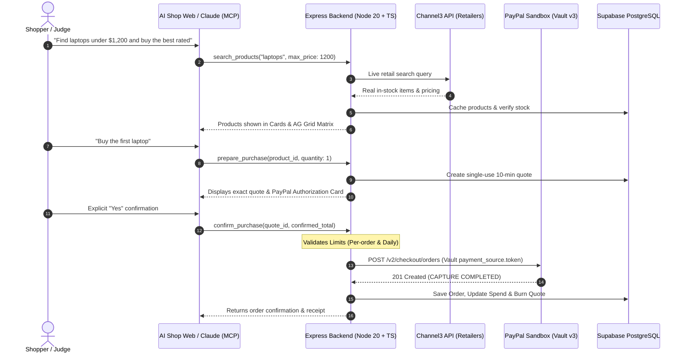

# AI Shop: The Future of Agentic Online Shopping

> **PayPal Hackathon 2026 Project** &middot; Autonomous AI shopping, live product discovery, and zero-friction vaulted PayPal payments. Powered & sponsored by **PayPal**, **Render**, and **Channel3**.

[](https://developer.paypal.com)
[](https://modelcontextprotocol.io)
[](https://trychannel3.com)
[](https://render.com)
[](https://www.ag-grid.com)
[](https://www.typescriptlang.org)
[](LICENSE)

---

## 1. Vision: The Future of Online Commerce

Traditional e-commerce funnels are fragmented: users bounce between search engines, retailer websites, cluttered filters, and tedious multi-step checkout forms. 

**AI Shop reimagines the entire shopping lifecycle as a conversational, agentic experience:**
1. **Talk to an AI Shopper**: Ask naturally (e.g. *"Find a gaming laptop under $1,200 with at least 16GB RAM"*).
2. **Real Retail Catalog**: The agent queries real-time retail offers via the **Channel3 API** across major merchants (Best Buy, Amazon, Target, Walmart).
3. **Multi-Dimensional Comparison**: Evaluate products through an embedded **AG Grid** comparison matrix to weigh prices, ratings, and discounts.
4. **Zero-Friction PayPal Vault Checkout**: The agent creates an exact quote and securely charges the user's vaulted **PayPal Sandbox Account** on the backend. No credit cards exposed, no checkout redirection.
5. **Human-in-the-Loop Safeguards**: Financial safety guardrails (per-order limits, daily spending limits, hard caps, and explicit affirmative confirmation) prevent runaway AI spending.

AI Shop works simultaneously as a responsive, modern web application and as an enterprise **Model Context Protocol (MCP)** server for **Claude Desktop**, **Claude.ai**, or any MCP-compatible AI client.

---

## 2. Architecture Overview



---

## 3. Key Innovations & Features

### 🛒 Real-Time Live Catalog (Channel3 API)
* Unlike standard mock hackathon stores, AI Shop indexes **real retail inventory** via Channel3.
* Every search dynamically updates database stock and current prices. 
* Prices for quotes and charges strictly come from the verified database record, preventing AI hallucination of costs.

### 💳 Autonomous PayPal Sandbox Vaulting
* **No Checkout Forms**: Users link their PayPal Sandbox buyer account once via PayPal Vault v3 (`setup-tokens` & `payment-tokens`).
* **Backend Tokenized Capture**: Orders are captured autonomously from the backend using vaulted payment tokens (`payment_source.token.id`).
* **Instant Receipts & Refunds**: Users can query past orders and initiate full or partial refunds through conversational AI commands.
* **Webhook Resilience**: Webhooks capture real-time lifecycle updates (`PAYMENT.CAPTURE.COMPLETED`, `PAYMENT.CAPTURE.REFUNDED`, `CUSTOMER.DISPUTE.*`).

### 🛡️ Financial Guardrails & Spending Limits
To safely delegate purchasing power to an AI agent, strict safety mechanisms are hardcoded:
* **Interactive Spending Limits UI**: Users can adjust their per-order and daily limits directly in the settings modal or by speaking to the assistant.
* **Server Hard Cap (`MAX_LIMIT`)**: Configurable ceiling (defaults to $200) that prevents limits from being increased arbitrarily.
* **Mandatory Human-in-the-Loop Authorization**: The AI generates a 10-minute price quote and strictly requires unambiguous affirmative consent (`yes`, `confirm`, `proceed`) before triggering charges.
* **Idempotency & Replay Defense**: Each quote UUID serves as the `PayPal-Request-Id` to guarantee zero double-charges.

### 📊 AG Grid Product Comparison
* Instant toggle between responsive cards view and an **AG Grid Community** comparison table.
* Sort, filter, and compare technical specs, discount percentages, and star ratings side-by-side.

### 🔌 Universal AI Integration (OAuth 2.1 + PKCE)
* Connects seamlessly to external LLM clients such as **Claude Desktop** and **Claude.ai** via Model Context Protocol.
* Built-in OAuth 2.1 authorization server with PKCE (S256), token rotation, and replay prevention.

---

## 4. The 14 Agent Tools

All 14 tools are shared identically between the MCP server and the built-in conversational web interface:

| Tool | Category | Description |
| :--- | :--- | :--- |
| `search_products` | Catalog | Live search across real retailer products with category & price filters |
| `get_product` | Catalog | Retrieve full details, description, rating, and stock for a product |
| `list_categories` | Catalog | List product categories with available inventory counts |
| `link_paypal_account` | PayPal | Generate one-time approve URL for sandbox vaulting |
| `get_paypal_link_status` | PayPal | Check active vault status (`NONE`, `PENDING`, `ACTIVE`, `REMOVED`) |
| `unlink_paypal_account` | PayPal | Disconnect saved PayPal vault account |
| `set_spending_limits` | Security | Adjust per-order and daily spend limits within server hard cap |
| `prepare_purchase` | Purchase | Validate stock & freeze pricing in a single-use 10-min quote |
| `confirm_purchase` | Purchase | Verify explicit user consent, enforce limits, and charge PayPal Vault |
| `get_order` | Orders | Fetch order details, capture status, and items by UUID |
| `list_my_orders` | Orders | Retrieve recent purchase history newest first |
| `refund_order` | Orders | Process full or partial refund for a captured PayPal order |
| `get_dispute` | Disputes | Fetch PayPal dispute status, reason, and contested amounts |
| `list_disputes` | Disputes | List buyer disputes and resolutions |

---

## 5. Quickstart Guide

### Prerequisites
* **Node.js**: v20 or higher
* **Supabase Project**: Free tier PostgreSQL database
* **PayPal Developer Account**: Sandbox app with Vaulting enabled
* **Channel3 API Key**: Free hackathon key from [trychannel3.com/developers](https://trychannel3.com/developers) (Promo: `PAYPAL-HACKATHON-2026`)
* **Groq API Key**: Free fast LLM inference key from [console.groq.com/keys](https://console.groq.com/keys)

### Step 1: Clone & Install Dependencies
```bash
git clone https://github.com/ayyandurai111/ai-shop.git
cd ai-shop
npm install
```

### Step 2: Database Setup
1. Create a project at [supabase.com](https://supabase.com).
2. In the Supabase SQL Editor, run [`supabase/migrations/001_init.sql`](supabase/migrations/001_init.sql), then [`supabase/migrations/002_oauth.sql`](supabase/migrations/002_oauth.sql).
3. In **Supabase Authentication > Users**, click **Add User** (enter any demo email and password, check auto-confirm). Copy the generated UUID for `DEMO_USER_ID`.

### Step 3: Configure Environment Variables
Copy `.env.example` to `.env` and fill in the values:
```env
NODE_ENV=development
PORT=3000
BASE_URL=http://localhost:3000

# Supabase
SUPABASE_URL=https://your-project.supabase.co
SUPABASE_ANON_KEY=your-anon-key
SUPABASE_SERVICE_ROLE_KEY=your-service-role-key
DEMO_USER_ID=your-supabase-user-uuid

# PayPal Sandbox
PAYPAL_CLIENT_ID=your-sandbox-client-id
PAYPAL_CLIENT_SECRET=your-sandbox-client-secret
PAYPAL_ENV=sandbox
PAYPAL_WEBHOOK_ID=your-sandbox-webhook-id

# Spending Limits Guardrails
MAX_LIMIT=200

# AI Model Inference (Groq)
LLM_API_KEY=your-groq-api-key
LLM_MODEL=openai/gpt-oss-120b

# Catalog (Channel3)
CHANNEL3_API_KEY=your-channel3-api-key
```

### Step 4: Run the Development Server
```bash
npm run dev
```
Open [http://localhost:3000/login](http://localhost:3000/login) and click **Continue as Demo User**.

### Step 5: One-Click Cloud Deployment on Render (Hackathon Sponsor)
AI Shop includes a turnkey [`render.yaml`](render.yaml) Blueprint for zero-friction cloud deployment on **Render**, an official hackathon sponsor:
1. Fork or push this repository to your GitHub account.
2. In the [Render Dashboard](https://dashboard.render.com), select **New +** &rarr; **Blueprint**.
3. Select your repository. Render automatically reads `render.yaml`, provisions the Node.js 20 web service, sets up the build and start commands, and configures the `/health` endpoint.
4. Input your environment secrets (`PAYPAL_CLIENT_ID`, `PAYPAL_CLIENT_SECRET`, `SUPABASE_URL`, etc.).
5. Your web app and live MCP server will be deployed at `https://<your-app>.onrender.com`.

---

## 6. Connecting External AI Clients (Claude Desktop / Claude.ai)

AI Shop exposes an enterprise **Model Context Protocol (MCP)** endpoint with full browser-based OAuth 2.1:

### Claude.ai or Claude Desktop (Connectors)
1. In Claude, navigate to **Settings > Connectors > Add Custom Connector**.
2. Enter only your server URL:
   ```
   https://<your-service>.onrender.com/mcp
   ```
3. Click **Connect**. A secure browser authentication window opens.
4. Click **Allow** to link your AI client.
5. Claude now has full access to AI Shop tools to browse, compare, and buy products!

### MCP Inspector (Testing)
```bash
npx @modelcontextprotocol/inspector
```
Select transport **Streamable HTTP** and enter `https://<your-service>.onrender.com/mcp`.

---

## 7. Automated Testing Suite

AI Shop includes an end-to-end testing suite to verify protocol compliance and financial safeguards:

```bash
# Run tool execution & safety rule tests (pricing locks, limit checks, quote expiry)
npm run test:smoke

# Run full OAuth 2.1 + PKCE test (discovery, token exchange, refresh rotation, replay defense)
npm run test:oauth
```

---

## 8. Two-Minute Hackathon Judge Demo Script

> 🔑 **Pre-configured PayPal Sandbox Buyer Account (For Judges):**
> * **Email**: `sb-dusil53813583@personal.example.com`
> * **Password**: `7b;r)VqM`
>
> *(Pre-funded sandbox account configured for seamless zero-friction testing)*

1. **Sign In**: Open the web application and click **Continue as Demo User**.
2. **Link PayPal Sandbox**: Click the **Link PayPal** badge in the header (or type *"Link my PayPal"*). Log in once with a PayPal Sandbox buyer account. The status badge turns green (`PayPal linked`).
3. **Explore Products**: Type *"Show me laptops under $1,200"*. Observe the instant response with discount badges, star ratings, and the AG Grid comparison view.
4. **Inspect Spending Guardrails**: Click the **Settings** icon in the header. Notice the Per-Order Limit ($50) and Daily Limit ($100). Try setting higher limits or use the quick presets.
5. **Prepare & Authorize Purchase**: Click **Buy this** on a product. The AI creates a verified quote and displays the interactive **PayPal Sandbox Vault** authorization card with the exact price.
6. **One-Click Checkout**: Click **Authorize & Pay with PayPal** (or reply *"yes"*). The backend captures payment autonomously from the vaulted token.
7. **View Orders & Refunds**: Open the **Orders** panel to see the live record, or ask the AI: *"Refund my last order"*.

---

## 9. Codebase Structure

```
├── public/                 # Modern responsive client UI
│   ├── chat.html           # Main AI shopping canvas, AG Grid comparison, settings modal
│   ├── login.html          # Clean demo authentication portal
│   └── paypal-return.html  # PayPal Sandbox vault return landing handler
├── src/
│   ├── index.ts            # Express server initialization, static routing, /mcp
│   ├── mcp.ts              # Model Context Protocol handler (Streamable HTTP)
│   ├── oauth.ts            # OAuth 2.1 authorization server, PKCE S256, token rotation
│   ├── auth.ts             # JWT authentication & session resolution
│   ├── chat.html           # Server-side chat orchestration & LLM conversion
│   ├── config.ts           # Type-safe environment variable helpers
│   ├── db.ts               # Supabase database client
│   ├── paypal.ts           # Direct PayPal Sandbox REST API integration
│   ├── routes.ts           # REST API routes (/api/chat, /api/settings, /api/orders)
│   ├── tools.ts            # The 14 Agent tools definition & Zod validation
│   └── services/           # Business logic layer
│       ├── channel3.ts     # Channel3 live retail search integration
│       ├── orders.ts       # Order persistence & capture handling
│       ├── paypalAccount.ts# Vault setup & payment token management
│       ├── products.ts     # Catalog querying & full-text search
│       ├── purchase.ts     # Quote creation & payment capture guards
│       └── settings.ts     # Spending limits enforcement & calculation
├── supabase/migrations/    # PostgreSQL schemas, triggers & RLS policies
└── render.yaml             # Render Blueprint deployment definition
```

---

## 10. Security & Compliance Notes

* **PayPal Sandbox Isolation**: The server strictly enforces `PAYPAL_ENV=sandbox` on startup to prevent accidental real-money transactions.
* **Vault Token Privacy**: Raw PayPal payment tokens and customer vault IDs are retained solely on the protected server backend; they are never leaked to client responses or LLM tool returns.
* **Price Tamper Resistance**: All quotes query product prices directly from the verified database table; models cannot specify or manipulate prices.
* **Cryptographic Storage**: Only SHA-256 hashes of OAuth authorization codes and tokens are stored in the database.

---

## 11. Hackathon Sponsors & Acknowledgements

AI Shop was proudly built for the PayPal Hackathon 2026, leveraging technology and infrastructure from the event sponsors:
* **PayPal**: Sandbox Vault v3, merchant order APIs, and agentic commerce rails.
* **Render**: Official cloud sponsor providing scalable Node.js container hosting and automated continuous deployment via `render.yaml`.
* **Channel3**: Live multi-merchant retail intelligence & real-time product discovery API.

---

## 12. License

This project is licensed under the [MIT License](LICENSE).

---

*Built with passion for the PayPal Hackathon 2026.*
